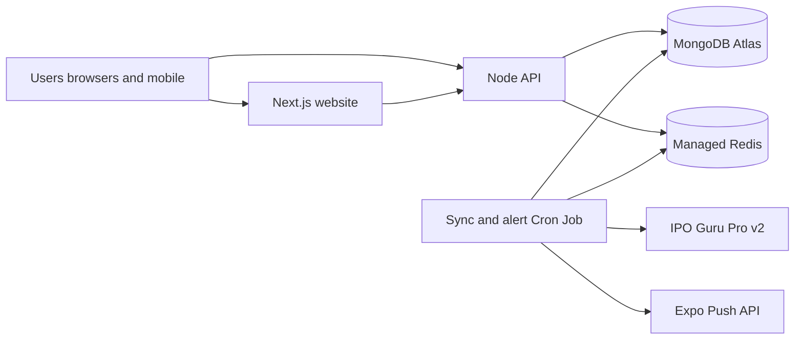

# Production deployment readiness — Prompt 84

**Date:** 3 November 2026 (Asia/Kolkata)\
**Scope:** Infrastructure readiness and configuration for a safe first public launch.\
**Does not:** purchase hosting or domains, modify DNS, create production databases, deploy services, start production workers, send push notifications, publish EAS updates, or flip production kill switches.

Companion docs: `production-deployment-runbook.md`, `database-redis-production.md`, `api-security-production.md`, `notifications-production.md`, `ipo-data-sync-production.md`, `sync-worker-ops.md`, `ipoguru-request-budget.md`, `website-seo-launch.md`, `mobile-release-eas.md`, `final-release-readiness.md`.

---

## 1. Recommended architecture

Independently deployable components that exist in this monorepo:

| Component | Location | Continuous? | Persistent storage | Public HTTPS | Private notes |
| --- | --- | --- | --- | --- | --- |
| Next.js website | `apps/web` | Yes (edge/SSR) | None required (stateless) | Yes | Talks only to IPO Singh API |
| Node.js API | `apps/api` (`src/index.ts`) | Yes | MongoDB; Redis optional for cache | Yes | Never expose IPO Guru key |
| Sync + notification Cron | `apps/api` (`src/cron.ts`) | No (Render Cron `*/5 * * * *`) | MongoDB + Redis required in staging/prod | No public routes | Same DB/Redis as API; see `render-cron.md` |
| MongoDB | Atlas (recommended) | Managed | Yes | Private (IP allowlist / VPC) | Lane-isolated DB names |
| Redis | Managed Redis | Managed | Ephemeral cache/locks | Private TLS | Key prefix `ipo-singh:{env}:…` |
| IPO Guru Pro v2 | Upstream HTTPS | Vendor | N/A | Server-only outbound | Quotas; never from clients |
| Android / iOS | `apps/mobile` | Client | Device SecureStore | Calls public API HTTPS | No Guru / Mongo / Redis secrets |
| Admin HTML + API | Web BFF + `/api/v1/admin` | Via website/API | MongoDB | Auth + CSRF + rate limits | Ops status behind `OPS_TOKEN` |

Scheduled vs continuous:

- **Must run continuously:** website, API.
- **Runs on Cron:** catalogue/GMP/subscription/history, allotment verify (kill-switched), alert evaluation, optional push receipts — `npm run start:cron`, IST windows inside the process, Render schedule `*/5 * * * *` UTC. See `render-cron.md`.
- **Do not** substitute a sleeping free-tier always-on worker; Cron must share production Mongo/Redis with the API.



Isolation rules enforced in code:

- `IPO_SINGH_DEPLOYMENT` lane (`development` \| `staging` \| `production` \| `test`).
- Staging hosts that use `NODE_ENV=production` **must** set `IPO_SINGH_DEPLOYMENT=staging` and a staging Mongo database name.
- Production Mongo DB names refuse `dev` / `test` / `staging`; non-production refuse bare `ipo-singh` and any name containing `prod`.
- Redis keys and sync locks: `ipo-singh:{dev|staging|prod|test}:…`.
- Staging/production CORS require HTTPS and refuse Cloudflare quick-tunnel hosts.
- Temporary Cloudflare tunnels are **not** staging or production endpoints.

---

## 2. Hosting options and tradeoffs

| Layer | Options considered | Initial recommendation | Why |
| --- | --- | --- | --- |
| Website | Vercel, Netlify, Node host | **Vercel** (or Netlify) for Next.js 16 | SSR/SEO, CDN, HTTPS, low ops; Node 24 compatible build |
| API | Render, Railway, Fly.io, small VPS | **Render Web Service** or **Railway** always-on | Persistent Node process; set `HOST`/`PORT`; TLS at edge |
| Sync Cron | Same provider as API | **Render Cron Job** (`start:cron`, `*/5 * * * *`) | One-shot passes with Redis locks; same Mongo/Redis as API |
| MongoDB | Atlas M0/M10, self-host | **MongoDB Atlas** dedicated cluster for prod | Backups, auth, network rules |
| Redis | Redis Cloud, Upstash, provider addon | **Redis Cloud** or host addon with TLS | Workers need reliable `SET NX` locks; avoid tiny free limits for prod |

Assessment notes (verify current vendor pricing before purchase):

- **Free-tier API sleep:** unsuitable for production API; Cron is schedule-driven and must still reach always-on Mongo/Redis.
- **Region:** prefer one region close to India users for API + Atlas + Redis (Singapore recommended for Render Cron).
- **Cron model:** one Render Cron Job is the production sync path; IST windows and Redis locks live in application code (`docs/render-cron.md`).
- **Operational complexity:** keep website on a PaaS and API + Cron on Render; avoid multi-cloud for launch.
- **Scalability path:** single API + single Cron → horizontal API replicas behind the same Redis locks → larger Atlas/Redis tiers.

**Do not** reuse ephemeral tunnels as permanent origins.

---

## 3. Environment variable inventory

Placeholders only. Never commit real secrets. Full commented catalogue: `apps/api/.env.example`, `apps/web/.env.example`.

### Website (`apps/web`)

| Variable | Prod | Notes |
| --- | --- | --- |
| `IPO_SINGH_SITE_URL` | Required https | Canonicals, sitemap, OG; no path; no tunnels |
| `IPO_SINGH_API_ORIGIN` | Required https | IPO Singh API only |
| `IPO_SINGH_PLAY_STORE_URL` | Optional | Empty until listed |
| `IPO_SINGH_APP_STORE_URL` | Optional | Empty until listed |

### API + worker (`apps/api`)

| Variable | Prod | Notes |
| --- | --- | --- |
| `NODE_ENV` | `production` | Ignores local `.env` Mongo load path; HSTS path |
| `IPO_SINGH_DEPLOYMENT` | `production` or `staging` | Staging must be explicit when `NODE_ENV=production` |
| `HOST` / `PORT` | Yes | Container bind |
| `CORS_ORIGINS` | Required https origin(s) | Exact website origins; no `*` |
| `TRUST_PROXY` | Provider-specific | Default `false`; when `true`, Express trusts **one hop** only |
| `MONGODB_URI` | Yes | Lane-safe database path |
| `REDIS_URL` | Required for staging/prod workers | Recommended for API cache |
| `OPS_TOKEN` | Strongly recommended | `/internal` ops; missing → dark |
| `IPO_DATA_PROVIDER` | `ipo-guru` when syncing | `mock` refused in production |
| `IPOGURU_*` | When live sync | Server-only; set budgets to purchased plan |
| `PUSH_DELIVERY_ENABLED` | Keep `false` until approved | Expo send/receipts |
| `ALLOTMENT_BROADCAST_ENABLED` | Keep `false` until approved | Confirmed allotment queue |
| `ALLOTMENT_VERIFY_ENABLED` | Keep `false` until approved | Registrar polling |
| `EXPO_PUSH_ACCESS_TOKEN` | Optional until push | Not in mobile bundles |
| Bootstrap admin / session secrets | Per auth docs | Never in git |

### Mobile (EAS / runtime)

| Variable | Notes |
| --- | --- |
| `EXPO_PUBLIC_IPO_SINGH_API_ORIGIN` | Stable https staging or production API |
| `EXPO_PUBLIC_IPO_SINGH_SITE_URL` | https site |
| `EXPO_PUBLIC_APP_ENV` | `preview` / `production` |
| Forbidden | IPO Guru keys, Mongo, Redis, `OPS_TOKEN`, admin passwords as `EXPO_PUBLIC_*` |

---

## 4. DNS and HTTPS requirements

Proposed examples only — **ownership is not assumed**: `iposingh.com` (website), `api.iposingh.com` (API).

Manual prerequisites (operator):

1. Register the domain with a registrar of choice.
2. Point apex and `www` to the website host (A/AAAA or CNAME per host docs).
3. CNAME or A record for `api` to the API host.
4. Enable managed HTTPS certificates on website and API edges.
5. Configure `www` → apex (or apex → `www`) redirect; set `IPO_SINGH_SITE_URL` to the **canonical** https origin.
6. Set `CORS_ORIGINS` to that canonical website origin (and preview origins only for staging).
7. Deep links / universal links / Digital Asset Links / Apple App Site Association: configure only after the final domain is owned; do not invent association file contents here.
8. Domain verification for store listings when required by Google/Apple.

Do not automate DNS from this repository.

---

## 5. Database setup

1. Create **separate** Atlas projects or at least separate databases: `ipo-singh-dev`, `ipo-singh-staging`, `ipo-singh` (production).
2. Application user with least privilege (read/write on app DB only).
3. Network access: allow only hosting egress IPs (or private endpoint); do not leave `0.0.0.0/0` after launch unless temporarily required and reviewed.
4. Indexes are defined in Mongoose models; first connect creates them — run against staging first and inspect.
5. Retention env vars (`GMP_RETENTION_DAYS`, etc.) control observation cleanup policy.
6. **Backups:** enable Atlas continuous/snapshot backups on production; document restore drill quarterly.
7. **Restore test:** restore a staging snapshot into a throwaway DB; verify catalogue + one account login path; never overwrite production during drills.
8. Do not copy development users into production.

Startup refuses unsafe DB name / deployment mismatches (`assertSafeDatabase`).

---

## 6. Redis setup

1. Separate instances **or** separate logical DB indexes per lane; never point staging at production Redis.
2. TLS URL (`rediss://`) for managed providers when offered.
3. Memory: set a maxmemory policy appropriate for cache (for example `allkeys-lru`) so locks/cache cannot unbounded-grow the instance — verify provider defaults.
4. Cache miss / Redis outage: API continues with degraded cache; values may be labeled stale; **workers fail closed** on lock acquisition (skip job).
5. Keys: `ipo-singh:{env}:v{n}:{namespace}:{resource}:{id}` and `ipo-singh:{env}:sync-lock:{name}`.
6. Do not cache PANs, tokens, passwords, or session secrets (key builder rejects sensitive id patterns).

---

## 7. API deployment

Exact commands supported by this repo (from monorepo root):

```bash
npm ci
npm run typecheck -w @ipo-singh/api
npm run lint -w @ipo-singh/api
npm run test -w @ipo-singh/api
npm run build -w @ipo-singh/api
npm run start -w @ipo-singh/api
```

Runtime checklist:

- Health: `GET /api/v1/health`
- Readiness: `GET /api/v1/ready` (Mongo required; Redis reported)
- Graceful shutdown via SIGTERM/SIGINT and `SHUTDOWN_TIMEOUT_MS`
- `TRUST_PROXY=true` only behind a host that overwrites `X-Forwarded-*`; Express uses hop count `1`
- Rate limits are in-process; multi-instance needs edge limits or a shared store later
- Ops: `OPS_TOKEN` required for internal status; admin routes need authenticated admin roles
- Secrets only in host secret manager / process env

---

## 8. Cron deployment

Production path (Render Cron Job) — details in `render-cron.md`:

```bash
npm run build -w @ipo-singh/api
npm run start:cron -w @ipo-singh/api
```

Schedule: `*/5 * * * *` (UTC). IST windows are evaluated inside the process.

Development one-shot manual sync (not for production; requires `SYNC_TOKEN`):

```bash
npm run sync:once -w @ipo-singh/api
```

Optional local continuous worker (not production):

```bash
npm run start:worker -w @ipo-singh/api
```

Requirements:

- Same `MONGODB_URI` lane as the API it feeds (never `ipo-singh-dev` in production).
- `REDIS_URL` required for staging and production (`SYNC_ALLOW_PROCESS_LOCAL_LOCK` refused for those lanes).
- Whole-pass + per-resource Redis locks prevent overlapping Cron retries.
- Kill switches stay off until authorized: `PUSH_DELIVERY_ENABLED`, `ALLOTMENT_BROADCAST_ENABLED`, `ALLOTMENT_VERIFY_ENABLED`.
- Conservative default polling already favors Standard-class day budgets (see `docs/ipoguru-request-budget.md`). Prefer lengthening `SYNC_GMP_COLLECTION_MS` toward 120 minutes if the paid day budget is tight.
- Staging and production **must not** share the same IPO Guru API key/day budget if both sync live — use separate keys or keep staging `IPOGURU_ENABLED=false` / mock-off with fixture data.

---

## 9. Website deployment

```bash
npm ci
IPO_SINGH_SITE_URL=https://CANONICAL_SITE \
IPO_SINGH_API_ORIGIN=https://CANONICAL_API \
  npm run build -w @ipo-singh/web
npm run start -w @ipo-singh/web
```

On Vercel/Netlify, set the same env vars in the project UI; production builds refuse localhost/tunnel site and API origins.

SEO surfaces (sitemap, robots, structured data, OG, canonicals) depend on `IPO_SINGH_SITE_URL`. Security headers and error pages ship with the Next app — verify after first preview deploy (manual).

---

## 10. Mobile API configuration

- Preview builds: `EXPO_PUBLIC_IPO_SINGH_API_ORIGIN` → stable **staging** HTTPS API.
- Production builds: production HTTPS API only.
- Re-test deep links after final domain cutover (Prompt 85+).
- Do not bake temporary tunnel URLs into release channels.

---

## 11. Notification activation prerequisites

Preserve Prompt 76A:

- **Mainboard:** opted-in eligible users/devices; no watchlist required.
- **SME:** opted-in **and** watchlisted for that IPO.
- Confirmed allotment broadcast follows the same board rules; enabling `ALLOTMENT_BROADCAST_ENABLED` does not bypass SME watchlist gates.

Activation order (manual approval):

1. Staging worker + Expo token + physical device.
2. `PUSH_DELIVERY_ENABLED=true` on staging only; verify tickets/receipts and invalid-token cleanup.
3. Confirm Mainboard volume remains manageable (`ALERT_MAINBOARD_MAX_NONCRITICAL_PER_DAY`, digest path).
4. Production push only after coordinated release testing (Prompt 85+).
5. Allotment broadcast last, after registrar verify policy is accepted.

Default remains **delivery off**.

---

## 12. Monitoring setup

Simple launch stack (no enterprise APM required):

| Signal | Method |
| --- | --- |
| Website up | Host uptime check on `/` |
| API up | Uptime on `/api/v1/health` |
| API ready | Uptime on `/api/v1/ready` (alert if Mongo down) |
| Redis / worker | Ops status via `OPS_TOKEN`; alert on rising sync failures |
| IPO Guru quota | Ops status usage counters; alert >80% of daily budget |
| Push | Worker logs for Expo errors; kill switch remains available |
| Process crashes | Host restart policy + notify on crash loop |

Suggested thresholds (tune after baseline):

- Ready endpoint failing 2 minutes → page on-call.
- Sync success gap > 3× expected GMP interval → investigate worker/Redis/Guru.
- Push failure rate > 10% of attempts while delivery enabled → disable `PUSH_DELIVERY_ENABLED`.

Do not create external monitoring accounts from this prompt.

---

## 13. Smoke tests

After a future authorized deploy (not run here):

1. `GET https://API/api/v1/health` → ok.
2. `GET https://API/api/v1/ready` → database ok.
3. Website home SSR loads Mainboard/SME without localhost errors.
4. One IPO detail page shows freshness timestamps.
5. Register/login on staging only; confirm CORS.
6. Worker log shows locked ticks without duplicate catalogue sync.
7. With push still disabled, alert evaluation may enqueue in-app notices only.

Local verification commands (this prompt):

```bash
npm run typecheck
npm run lint
npm test
npm run build -w @ipo-singh/api
IPO_SINGH_SITE_URL=https://www.example-ipo-singh.test \
IPO_SINGH_API_ORIGIN=https://api.example-ipo-singh.test \
  npm run build -w @ipo-singh/web
```

CI workflow (no auto-deploy): `.github/workflows/ci.yml`.

---

## 14. Rollback procedures

1. **Website:** redeploy previous Vercel/Netlify deployment / git tag.
2. **API / worker:** redeploy previous image or `dist` artifact from last known-good tag; keep Mongo/Redis unchanged.
3. **Config mistake:** revert env vars; restart API and worker.
4. **Bad data sync:** stop worker; keep API serving last stored observations; fix provider/config; resume.
5. **Push incident:** set `PUSH_DELIVERY_ENABLED=false` immediately (and `ALLOTMENT_BROADCAST_ENABLED=false` if relevant).
6. Database restore only from tested Atlas snapshots; never restore production over staging without a written plan.

Tag releases deliberately (`vX.Y.Z`); production promote requires human approval — CI does not auto-deploy production.

---

## 15. Incident response

| Class | First actions |
| --- | --- |
| API down | Check host, `/health`, `/ready`, Mongo Atlas status |
| Stale catalogue | Check worker process, Redis locks, IPO Guru budgets/429 |
| Auth outage | Check Mongo sessions; do not rotate all cookies without notice |
| Push storm / complaints | Disable `PUSH_DELIVERY_ENABLED`; inspect engine digests |
| Suspected key leak | Rotate IPO Guru key, `OPS_TOKEN`, DB users, Expo token; review logs for redaction gaps |

Escalate to the operator who owns Atlas, DNS, and Expo credentials. Keep customer communications factual; never invent market data.

---

## 16. Cost considerations

Indicative categories only — **verify current vendor prices** before purchase.

| Item | Free-tier possibility | Likely paid for launch | Usage-dependent | One-time |
| --- | --- | --- | --- | --- |
| Website (Vercel/Netlify) | Hobby possible | Pro if team/limits | Bandwidth | Domain DNS |
| API always-on | Rarely reliable free | Small paid instance | Egress | — |
| Worker always-on | Unsuitable free sleep | Second small instance | — | — |
| MongoDB Atlas | M0 for **dev/staging only** | Dedicated prod cluster | Storage/IOPS | — |
| Redis | Tiny free for experiment | Small paid for prod locks | Memory | — |
| IPO Guru plan | Evaluation only | Purchased commercial tier | Over-quota blocked | — |
| Domain + email | — | Annual domain | — | Registration |
| Monitoring | Free uptime tier | Paid if SMS | Checks | — |
| Apple / Google developer | — | Annual / one-time fees | — | Enrollment |
| Expo EAS | Free limits | Production builds | Build minutes | — |

Affordable launch shape: Vercel hobby/pro website + one paid API + one paid worker + Atlas paid + small Redis + commercial IPO Guru + domain. Upgrade path: larger Atlas/Redis, API replicas, edge rate limits, paid uptime SMS.

---

## 17. Manual prerequisites

- [ ] Domain purchased and DNS planned (not assumed done).
- [ ] Atlas production + staging clusters/DBs created by operator.
- [ ] Redis production + staging provisioned.
- [ ] Host accounts for website, API, worker.
- [ ] Secrets placed in host secret stores (Guru key, `OPS_TOKEN`, Mongo, Redis, Expo).
- [ ] `IPOGURU_MINUTE_BUDGET` / `IPOGURU_DAILY_BUDGET` matched to purchased plan; app `PROVIDER_*` ceilings aligned.
- [ ] Staging HTTPS API for mobile preview (not a tunnel).
- [ ] Monitoring uptime checks configured.
- [ ] Explicit approval before `PUSH_DELIVERY_ENABLED` / allotment switches.
- [ ] Prompt 85 coordinated Android / iOS / website testing after infra exists.

---

## 18. Outstanding blockers

| ID | Severity | Blocker |
| --- | --- | --- |
| B1 | CRITICAL | No authorized production hosts, Atlas, or Redis yet |
| B2 | CRITICAL | Domain not confirmed owned/configured |
| B3 | HIGH | Production secrets not issued in a secret manager |
| B4 | HIGH | Staging HTTPS API still required for mobile cutover (tunnel not allowed) |
| B5 | HIGH | IPO Guru production key + budgets not activated in prod env |
| B6 | MEDIUM | Push delivery deliberately disabled pending device verification |
| B7 | MEDIUM | In-process rate limits only (multi-instance needs edge/shared store) |
| B8 | LOW | Optional admin HTML middleware gate |
| B9 | LOW | Exact vendor list prices require verification at purchase time |

---

## Prompt 84 readiness verdicts

| Gate | Verdict |
| --- | --- |
| Website deployment readiness | **READY** (config + build path; deploy not performed) |
| Backend deployment readiness | **READY** (config guards + build path; deploy not performed) |
| Database & Redis readiness | **READY** (isolation + docs; infra not provisioned) |
| Worker readiness | **READY** (Redis required in staging/prod; not started in prod) |
| Production notification readiness | **BLOCKED** (kill switches off; awaits staging device proof + approval) |
| Ready for Prompt 85 | **YES** (final coordinated testing can proceed once staging HTTPS exists) |
